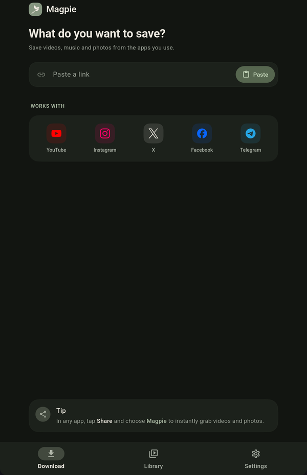
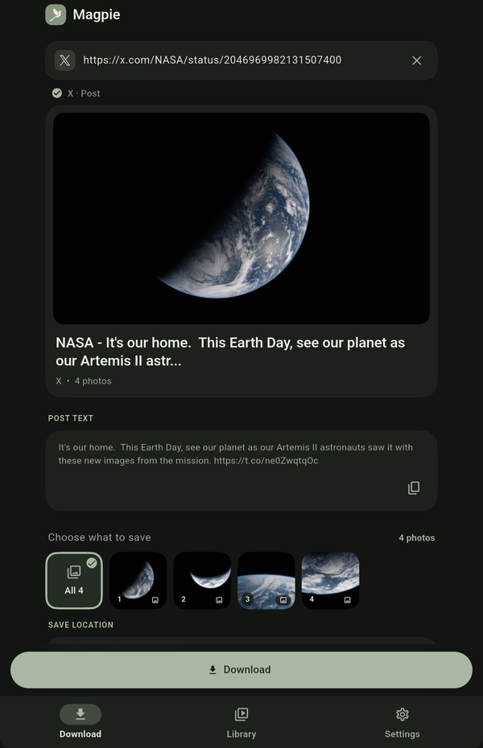
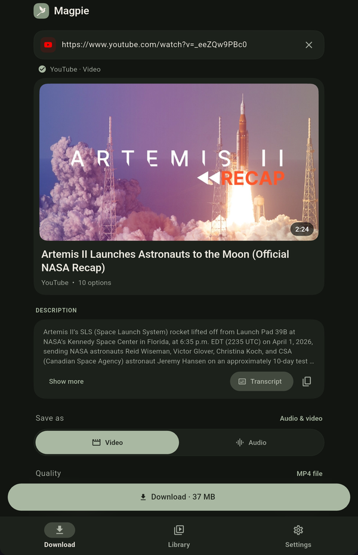
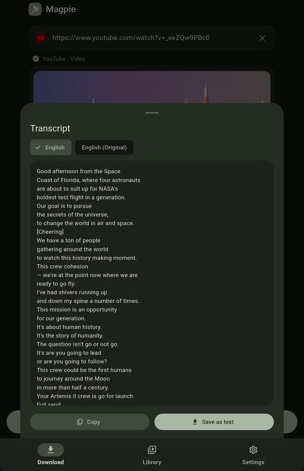
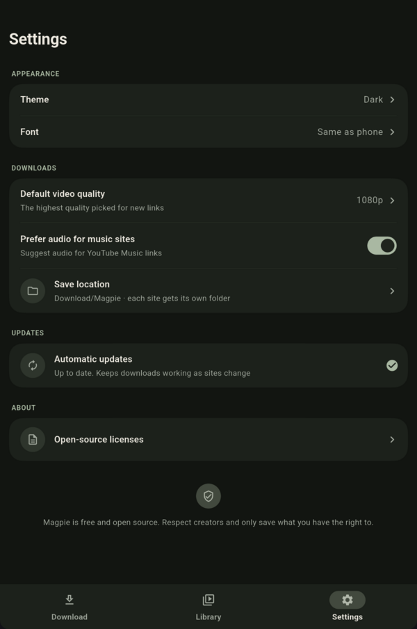

<div align="center">


# Magpie

**Save videos, audio and photos from the web, straight to your Android phone.**

[](https://github.com/snehangshu2002/magpie/releases/latest)
[](https://github.com/snehangshu2002/magpie/releases)


[](LICENSE)

[**Download the latest APK**](https://github.com/snehangshu2002/magpie/releases/latest)

[Features](#features) · [Install](#install) · [FAQ](#faq) · [Privacy](#privacy) · [Contributing](#contributing)

</div>

---

Magpie is a free and open-source downloader for Android. Share a link from
YouTube, Instagram, X (Twitter), Facebook or
[hundreds of other sites](https://github.com/yt-dlp/yt-dlp/blob/master/supportedsites.md),
choose what you want, and Magpie saves it to your phone's `Download` folder,
where your gallery and file manager can see it.

No account. No ads. No tracking.

> [!NOTE]
> Magpie is in early development. If something doesn't work,
> [open an issue](https://github.com/snehangshu2002/magpie/issues) and say
> which site and what happened.

## Screenshots

<p align="center">
  
  &nbsp;
  
  &nbsp;
  
</p>
<p align="center">
  
  &nbsp;
  
</p>
<p align="center"><sub>Photos and video shown: NASA (public domain).</sub></p>

## Features

- **Share or paste**: send a link from any app's share sheet, or paste it in.
- **Pick what you want**: video in the quality you choose, audio only, or
  photos. From a post with several photos or videos, save all of them or
  just the ones you pick.
- **Best quality**: choose **Best available** to get the highest quality a
  site offers, even above 4K. Photos from X posts are saved at the largest
  size the site serves, and a direct link to an image saves the full-size
  file.
- **Descriptions and captions**: read a video's description, or the caption
  or text of an Instagram, Facebook or X post, and copy it in one tap.
- **YouTube transcripts**: read a video's transcript in any of its caption
  languages, copy it, or save it as a text file next to your downloads.
- **Fit for sharing**: make a smaller copy of a saved video, sized to send
  in a chat app.
- **Downloads that keep going**: downloads run in the background with a
  progress notification, so you can leave the app.
- **Tidy folders**: files are saved to `Download/Magpie/<Site>/`, or to a
  folder of your choice inside `Download`.
- **Library**: search and filter everything you've saved; open, share or
  delete one file or many at once.
- **Keeps working**: the download engine updates itself, so sites keep
  working as they change.
- **Update notifications**: Magpie tells you when a new version is out and
  fetches the right APK for your phone.
- **Your look**: light, dark or system theme, and a choice of fonts.
- **Private**: no account, no ads, no tracking; Settings shows what stays on
  your phone and what Magpie connects to.

## Install

Magpie is distributed through GitHub, not the Play Store.

1. Open the [latest release](https://github.com/snehangshu2002/magpie/releases/latest).
2. Download the APK for your phone:

   | APK | For |
   |---|---|
   | `magpie-<version>-arm64-v8a.apk` | Almost all phones from the last several years. **Pick this if unsure.** |
   | `magpie-<version>-armeabi-v7a.apk` | Older or low-end phones |
   | `magpie-<version>-x86_64.apk` | Emulators and some Chromebooks |

3. Open the downloaded file. If Android asks, allow your browser to install
   apps, then tap **Install**.

Requires Android 7.0 or newer. After that, Magpie lets you know when an
update is available.

## FAQ

**Where are my downloads?**
In your phone's `Download/Magpie` folder, one folder per site. They also
appear in your gallery or music app. You can choose another folder inside
`Download` in **Settings → Save location**.

**A link that used to work has stopped working.**
Sites change often. Magpie updates its download engine every time it
starts, so close and reopen the app and try again. If it still fails,
please [report it](https://github.com/snehangshu2002/magpie/issues).

**Why isn't Magpie on the Play Store?**
Google Play doesn't allow apps that download from YouTube. Every release is
built and signed automatically from this repository by
[GitHub Actions](.github/workflows/release.yml).

**Can it download private or paid content?**
No. Magpie only saves what you can already view without logging in, and it
never bypasses DRM, paywalls or private accounts.

**Android says the app can't be installed.**
If you installed a copy you built yourself, uninstall it first. Releases are
signed with a different key, and Android won't install one over the other.

## Privacy

Magpie has no accounts, analytics or ads, and it collects nothing about you.
It only connects to:

- the sites whose links you give it, to download them;
- GitHub, to update its download engine and to check for new versions of
  the app.

Your files stay on your phone. Magpie never asks for access to all your
files; it saves through Android's own media storage. The app says the same
under **Settings → About → Your privacy**.

## Built with

| Part | Technology |
|---|---|
| App and UI | [Flutter](https://flutter.dev), Material 3, Riverpod, go_router |
| Downloading | [yt-dlp](https://github.com/yt-dlp/yt-dlp) and FFmpeg via [youtubedl-android](https://github.com/yausername/youtubedl-android) |
| Background downloads | Android foreground service |
| Saving files | Android MediaStore |
| Download history | [drift](https://drift.simonbinder.eu) (SQLite) |

## Contributing

Bug reports, ideas and pull requests are welcome.

- **Found a bug?** [Open an issue](https://github.com/snehangshu2002/magpie/issues)
  with your Android version, the site, and what you expected to happen.
  Please don't post links to copyrighted content.
- **Want to change something bigger?** Open an issue first, so we can agree
  on the approach before you spend time on it.

### Building from source

You'll need Flutter (stable, Dart 3.13+), the Android SDK with platform 37,
JDK 17, and an Android 7.0+ device or emulator.

```sh
git clone https://github.com/snehangshu2002/magpie.git
cd magpie
flutter pub get                # dependencies and localizations
dart run build_runner build    # generated models, providers and database code
flutter run
```

Generated code isn't committed, so run `dart run build_runner build` again
after pulling changes.

### Project layout

```
lib/
  core/        shared code: platform channels, database, theme, errors
  features/    one folder per feature (intake, download, library, settings, updater),
               each split into presentation / domain / data
android/app/src/main/kotlin/
               native side: yt-dlp, the download service, MediaStore
```

Native work is done in Kotlin and reached from Dart only through the
platform channels in `lib/core/platform/`.

### Before opening a pull request

```sh
dart format .
flutter analyze
flutter test
```

Keep pull requests small and focused, follow the structure of the code
around your change, and add tests for new logic. Don't use real copyrighted
media links in tests, docs or screenshots.

## Responsible use

Magpie is meant for saving media you have the right to keep, such as your
own uploads, public-domain works, or content whose licence allows it. Please
respect creators and each site's terms of service.

## Acknowledgements

Magpie stands on the work of these projects:

- [yt-dlp](https://github.com/yt-dlp/yt-dlp) and
  [youtubedl-android](https://github.com/yausername/youtubedl-android), which
  do the downloading
- [FFmpeg](https://ffmpeg.org), for merging and converting streams
- [Simple Icons](https://simpleicons.org), for site logos
- [Inter](https://rsms.me/inter/) and
  [Source Serif 4](https://github.com/adobe-fonts/source-serif), the app's
  fonts

## License

Magpie's source code is released under the [MIT License](LICENSE).

The app also bundles third-party components under their own licences, most
notably [youtubedl-android](https://github.com/yausername/youtubedl-android)
(GPL-3.0), yt-dlp (Unlicense) and FFmpeg. If you redistribute a build of
Magpie, you must follow those licences too.

<div align="center">

If Magpie is useful to you, consider giving it a ⭐

</div>
